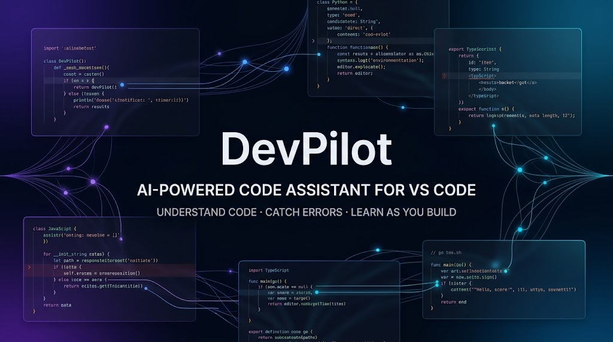
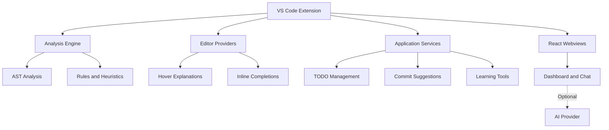

# DevPilot

### AI-Powered Code Assistant for Visual Studio Code

**Understand Code · Catch Errors · Learn as You Build**

An offline-first developer productivity extension that combines code analysis, contextual explanations, refactoring suggestions, and educational tools to help developers understand and improve their code.

[Features](#-key-features) · [Architecture](#-architecture) · [Documentation](#-documentation) · [Getting Started](#-getting-started)

---

## ✨ Why DevPilot?

AI coding tools can help developers generate code, but understanding existing code is equally important.

**DevPilot is designed to support the development and learning process** through offline-first analysis, contextual explanations, code suggestions, and integrated productivity features.

- **Understand:** Explore code patterns, language constructs, and program structure.
- **Analyze:** Identify potential issues through static analysis and curated rules.
- **Improve:** Receive suggestions for readability, maintainability, and refactoring.
- **Learn:** Use educational resources, quizzes, and contextual coding assistance.
- **Stay productive:** Track TODO comments and generate meaningful commit messages.

## 🚀 Key Features

### 🎯 Intelligent Code Assistance

- **Hover explanations** for JavaScript and TypeScript keywords, built-ins, and methods.
- **Inline completions** based on common coding patterns.
- **Contextual suggestions** designed to support developers while they code.
- **Snippet cursor positioning** to make generated snippets easier to complete.

### 🐛 Code Analysis & Error Detection

- AST-based structural inspection.
- Detection of selected issues, including unused variables, type-related patterns, and potential null references.
- Explanations and suggested fixes for supported patterns.
- Offline analysis using native rules and heuristics.

### 🔧 Refactoring & Code Quality

- Readability suggestions, including template literals and optional chaining.
- Maintainability improvements, such as simplifying nested expressions.
- Performance-oriented recommendations for supported patterns.
- Security-related guidance for selected coding practices.

*Available analysis and refactoring rules depend on the language and pattern being inspected.*

### 📊 Structural Analysis

- Extract code symbols such as functions, classes, variables, and imports.
- Inspect code structure through AST-based analysis.
- Calculate supported complexity metrics.
- Explore patterns and relationships within analyzed code.

### 🗂️ Workspace Awareness

- Detect project metadata from files such as `package.json`, `pyproject.toml`, and `go.mod`.
- Provide workspace structure information.
- Support dependency-aware context and related-file suggestions where implemented.

### 💬 Learning & Productivity

| Feature | Purpose |
| --- | --- |
| Learning assistant | Get contextual help with coding concepts. |
| Quiz runner | Practice HTML, CSS, and JavaScript fundamentals. |
| TODO tracker | Find and manage TODO comments in the workspace. |
| Commit generator | Create meaningful commit-message suggestions from code changes. |
| Learning resources | Explore supporting material and coding guidance. |

### 🤖 Optional AI Assistance

DevPilot combines native analysis with optional language-model assistance when configured.

- Optional OpenAI integration.
- Offline-first features that remain available without an AI API key.
- Additional provider integrations only where supported by the configured implementation.

**Note:** Offline analysis and AI-generated responses are separate capabilities. AI availability depends on the provider configuration and network requirements.

---

## 🎥 DevPilot Demo

Watch DevPilot in action to explore its features, interface, and developer workflow.

**[▶ Watch the Full Demo on YouTube](https://youtu.be/80OhS_xvNkM)**

---

## 🏗️ Architecture

DevPilot follows a modular design that separates analysis, editor integration, application services, and user-interface components.

*This is a conceptual overview; the exact modules and integrations depend on the implementation in the repository.*

## 🧰 Technology Stack

| Technology | Role |
| --- | --- |
| TypeScript | Extension logic and application services |
| VS Code Extension API | Editor integration and extension features |
| Babel | AST parsing and code analysis |
| React | Interactive webview interfaces |
| Radix UI | Accessible UI primitives |
| Tailwind CSS | Interface styling |
| esbuild | Build tooling |
| Jest | Testing where configured |

## 🌐 Language Support

DevPilot includes multi-language detection and analysis features. The depth of support varies by language.

| Language | Analysis | Completions | Refactoring |
| --- | --- | --- | --- |
| JavaScript | Supported | Supported | Supported patterns |
| TypeScript | Supported | Supported | Supported patterns |
| Python | Supported patterns | Limited or verify | Verify |
| Go | Supported patterns | Limited or verify | Verify |
| Rust | Supported patterns | Limited or verify | Verify |
| Java | Supported patterns | Limited or verify | Verify |
| C# | Supported patterns | Limited or verify | Verify |
| C++ | Supported patterns | Limited or verify | Verify |
| HTML / CSS | Supported patterns | Verify | Verify |

*Confirm the current implementation before treating every capability in this table as fully supported.*

## 📋 Requirements

- Visual Studio Code version **1.104.0 or newer**, as specified by the current project documentation.
- Node.js 18 or newer for development, subject to the project's build configuration.
- An API key and network access only for optional cloud AI features that require them.

## 🚀 Getting Started

### Using DevPilot

1. Open Visual Studio Code.
2. Open a supported JavaScript or TypeScript file.
3. Hover over code to explore available explanations.
4. Type code to see available inline suggestions.
5. Open the DevPilot sidebar to explore its available features.

If the extension is not available through a verified Marketplace listing, follow the repository's documented development or VSIX installation process instead of assuming that searching the Marketplace will find it.

### Configuring Optional AI Features

1. Open the VS Code Command Palette with `Ctrl+Shift+P` on Windows/Linux or `Cmd+Shift+P` on macOS.
2. Look for the documented DevPilot API-key command.
3. Configure the provider credentials according to the project's instructions.
4. Avoid committing API keys or other secrets to source control.

## ⚙️ Extension Settings

The existing project documentation lists these settings:

| Setting | Purpose | Default |
| --- | --- | --- |
| `devpilot.enableHoverExplanations` | Enable hover explanations | `true` |
| `devpilot.enableInlineCompletions` | Enable inline suggestions | `true` |
| `devpilot.enableSnippetCursors` | Enable snippet cursor positioning | `true` |
| `devpilot.debounceDelay` | Analysis debounce delay in milliseconds | `400` |
| `devpilot.maxCompletionItems` | Maximum inline suggestions | `5` |
| `devpilot.useNativeMode` | Enable native analysis | `true` |
| `devpilot.useLLMMode` | Enable optional LLM features | `true` |

*The available settings and defaults should be checked against the current extension manifest.*

## 📚 Documentation

For detailed information about the project, consult the documentation included in this repository:

- [Full Documentation](FULL_DOCUMENTATION.md)
- [Source Code](.)
- [License](LICENSE)

## 🛣️ Development Roadmap

Potential areas for continued development include:

- Expanded refactoring support across languages.
- Improved analysis accuracy and diagnostic explanations.
- Debugging and testing workflow integrations.
- A more comprehensive settings interface.
- Automated testing and continuous integration.
- Broader language-specific rules and completion patterns.

These items should be treated as planned work unless they have already been implemented.

## 🐛 Reporting Issues

Found a bug or have a feature request?

Visit the [DevPilot repository issues](https://github.com/abihaha7/DevPilot_v1_backup_final/issues) and include:

- A clear description of the problem.
- Steps to reproduce it.
- Expected and actual behavior.
- Your VS Code version and relevant error messages.

## 🤝 Contributing

Contributions and suggestions are welcome, subject to the repository's contribution guidelines.

1. Fork the repository.
2. Create a feature branch.
3. Make and test your changes.
4. Submit a pull request.

See [Full Documentation](FULL_DOCUMENTATION.md) for further guidance.

## 📄 License

See the repository's [LICENSE](LICENSE) file for the applicable license terms.

---

**Built to help developers understand code, improve their workflows, and keep learning.**

*Happy coding with DevPilot! 🚀*

